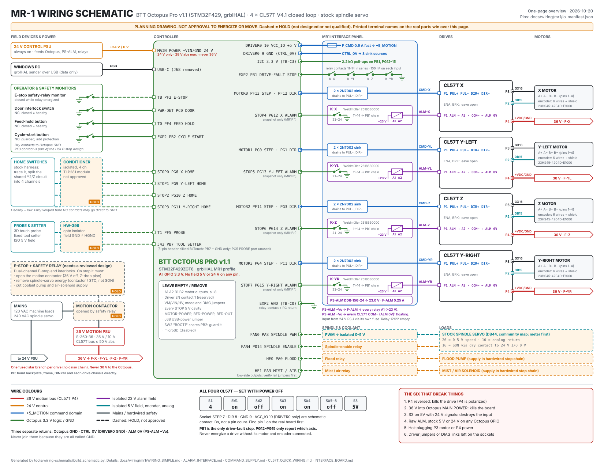

# MR1 wiring — current reference

**One-page schematic:** [MR1-SCHEMATIC.svg](MR1-SCHEMATIC.svg) puts the
official Octopus Pro V1.1 board picture in the middle of one landscape page,
outlines every connector this build uses, and routes each one to a card that
says what lands on its pins: the four CL57T drives, alarm relays, homes,
probe, operator inputs, spindle, coolant and power. Open it in a browser from
your checkout, or print it. Like the visual guide, it loads the BIGTREETECH
board image from the publisher; GitHub's inline preview below shows only the
outlines and routes. It is generated by `tools/wiring-schematic/build_schematic.py`,
which checks every drawn GPIO against `io-manifest.json`.

Open the [visual guide](visual/index.html) from your local checkout and choose
**Octopus schematic** for the board, driver jumpers and named terminal destinations.
Use cable tracing for motor, encoder, drive alarm, home-switch and other defined
circuits. The BIGTREETECH image needs internet; the tables work offline.

Choose **Drive plugs & colors** for P1 commands, P2 encoder, P3 motor, P4 power
and P5 tuning. The tables show numbered GX16/DB15 pins, both published motor
color options, all six encoder wires and the separate shield. Home references
distinguish the reported factory shared Y2/Z circuit from this project's four
independent inputs. Published mappings still require checking against each
actual connector and cable.

**Physical wiring and machining are not qualified.** No entry in the guide records
completed electrical acceptance. Software tests have used synthetic controllers.
The readiness worksheet lists the blocking holds before energizing: the E-stop /
hazardous-energy design, the E-stop monitor contact, the onboard SW2 on PB2,
STEP/DIR behavior during controller reset, and the PB1 fault chain before
coupled dual-Y motion.

- [Readiness worksheet](MR1-wiring-readiness.md)
- [Second-pass corrections](MR1-wiring-second-pass.md)
- [One-page schematic](MR1-SCHEMATIC.svg)
- [Wiring plan](mr1/WIRING.md) and [short check card](mr1/WIRING_SIMPLE.md)
- [Alarm relay interface](mr1/ALARM_INTERFACE.md), its [wire list](mr1/alarm-interface-wires.csv) and the [2026-09-27 alarm update](ALARM-UPDATE-2026-09-27.md)
- [Command supply and STEP/DIR sinks](mr1/COMMAND_SUPPLY.md)
- [CL57T setup](mr1/CL57T_QUICK_WIRING.md) and [arrival worksheet](mr1/CL57T_ARRIVAL_CAPTURE.md)
- [Interface](mr1/INTERFACE_BOARD.md) and [connector schedule](mr1/PIGTAIL_SCHEDULE.md)
- [Cable schedule](mr1/cable-schedule.csv) and [I/O manifest](mr1/io-manifest.json)
- [66-setting profile](mr1/expected-settings.json)

All drives are external CL57T units. Keep Octopus A1/A2/B2/B1 motor-output plugs
empty. The guide identifies the separate empty driver-socket signals and jumper
groups; it does not assume an installed plug-in driver adapter.

Oil/lubrication has no assigned circuit. Spindle/coolant loads, control interfaces,
alarm supervision, connector positions and power protection remain subject to
the documented checks. Generic TLP281/HW-399 interfaces remain unqualified; there
is no approved floating-VCC recipe.

Manufacturer references are linked, rather than redistributed:

- [CL57T V4.1 manual](https://www.omc-stepperonline.com/download/CL57T-V41_user_manual.pdf)
- [BIGTREETECH V1.1 schematic](https://github.com/bigtreetech/BIGTREETECH-OCTOPUS-Pro/blob/master/Hardware/BIGTREETECH%20Octopus%20Pro%20V1.1-sch.pdf)
- [BIGTREETECH V1.1 pin drawing](https://github.com/bigtreetech/BIGTREETECH-OCTOPUS-Pro/blob/master/Hardware/BIGTREETECH%20Octopus%20Pro%20V1.1-Pin.jpg)

`source/` preserves audit inspection excerpts; it is not a build tree.
`application-reference/wiring-installation.js` matches the current
`mr1-control/src/wiring-installation.js` after its reference-provenance header.
Complete exported firmware is
at [grblHAL-STM32F4](../../grblHAL-STM32F4/) and the current application is at
[mr1-control](../../mr1-control/). The private offline guide can be rebuilt from
the same maintained source with the exact original board image.
